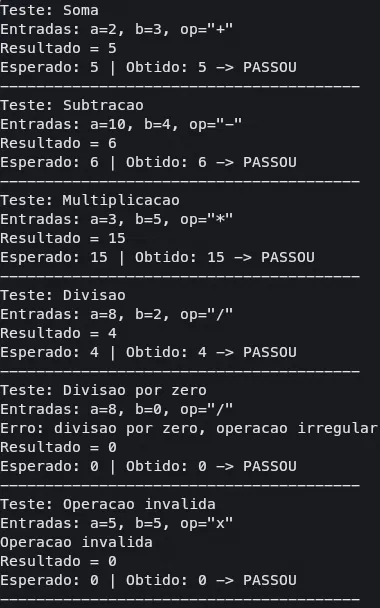
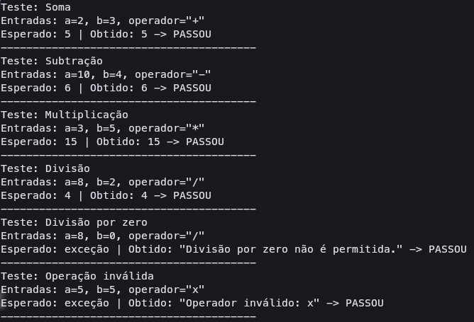
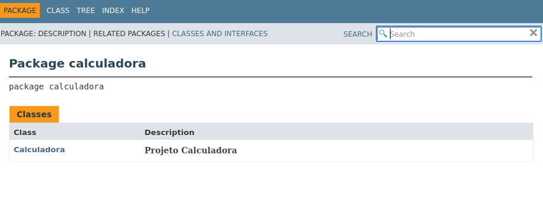
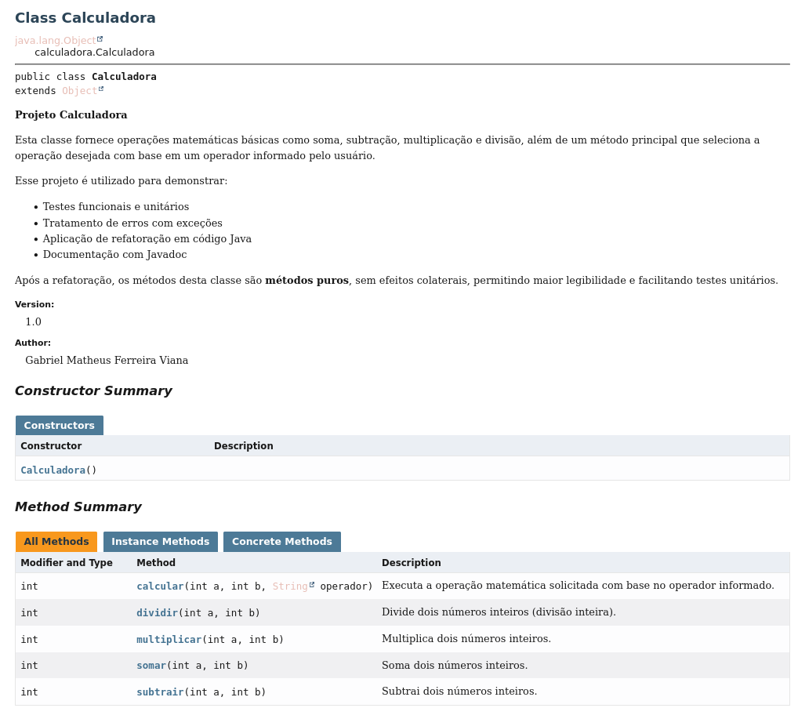

# Projeto Calculadora - FinançApp

> Projeto acadêmico desenvolvido com foco em Qualidade de Software, Testes, Refatoração, Documentação e Versionamento.

---

## 1. Identificação do Projeto

**Projeto:** Projeto Calculadora  
**Contexto:** FinançApp  
**Aluno:** Gabriel Matheus Ferreira Viana  
**RA:** 252088  
**Curso:** Análise e Desenvolvimento de Sistemas  
**Disciplina:** UX/UI e Testes de Software  
**Professor:** Daniel Ohata  
**Semestre:** 2026.2  

---

# 2. Visão Geral

O projeto consiste no desenvolvimento de um módulo de cálculos matemáticos básicos em Java para a startup fictícia **FinançApp**.

O módulo foi desenvolvido com o objetivo de ser utilizado futuramente em funcionalidades de controle financeiro, como:

- orçamento mensal;
- divisão de despesas;
- projeções financeiras;
- cálculos auxiliares.

Além do funcionamento correto das operações, o projeto aplica práticas de qualidade de software relacionadas a:

- testes;
- tratamento de erros;
- refatoração;
- documentação;
- versionamento;
- manutenção de código.

---

# 3. Problema

Durante o desenvolvimento da aplicação FinançApp, foi identificada a necessidade de criar um módulo matemático reutilizável.

Entretanto, a equipe definiu que o módulo não deveria apenas funcionar corretamente, mas também apresentar:

- código legível;
- testes automatizados;
- tratamento de falhas;
- documentação técnica;
- controle de versões;
- facilidade de manutenção.

O desafio consiste, portanto, em desenvolver uma solução funcional e ao mesmo tempo aplicar boas práticas de Engenharia de Software.

---

# 4. Objetivo

## 4.1 Objetivo Geral

Desenvolver uma calculadora em Java aplicando práticas de qualidade, testes, documentação, refatoração e versionamento.

## 4.2 Objetivos Técnicos

- implementar operações matemáticas básicas;
- tratar entradas inválidas;
- impedir divisão por zero;
- desenvolver testes automatizados;
- refatorar o código sem alterar seu comportamento;
- documentar classes e métodos com JavaDoc;
- gerar documentação HTML;
- utilizar Git e GitHub;
- organizar commits e branches;
- manter documentação técnica no README.

---

# 5. Escopo Funcional

A aplicação deverá oferecer as seguintes operações:

| ID | Funcionalidade | Descrição | Status |
|---|---|---|---|
| RF01 | Soma | Soma dois números inteiros | ✅ |
| RF02 | Subtração | Subtrai dois números inteiros | ✅ |
| RF03 | Multiplicação | Multiplica dois números inteiros | ✅ |
| RF04 | Divisão | Divide dois números inteiros | ✅ |
| RF05 | Validação de divisão | Impede divisão por zero | ✅ |
| RF06 | Operação inválida | Trata operadores não suportados | ✅ |

---

# 6. Requisitos Não Funcionais

| ID | Categoria | Requisito |
|---|---|---|
| RNF01 | Qualidade | O código deve possuir organização e legibilidade |
| RNF02 | Testabilidade | As operações devem possuir testes automatizados |
| RNF03 | Manutenção | O código deve permitir refatoração sem alteração funcional |
| RNF04 | Documentação | Classes e métodos devem possuir JavaDoc |
| RNF05 | Versionamento | O projeto deve utilizar Git e GitHub |
| RNF06 | Confiabilidade | Erros não devem interromper inesperadamente a execução |

---

# 7. Tecnologias Utilizadas

| Tecnologia | Versão | Utilização |
|---|---|---|
| Java | 27 | Desenvolvimento |
| JDK | 27 | Compilação |
| JUnit | Não utilizado | Os testes foram feitos na classe `TesteCalculadora`, executada pelo método `main` |
| Git | 2.56.0 | Controle de versão |
| GitHub | - | Repositório remoto |
| JavaDoc | - | Documentação |
| IDE | VS Code | Ambiente de desenvolvimento |

---

# 8. Estrutura do Projeto

```text
projeto_calculadora/
│
├── src/
│   └── calculadora/
│       └── Calculadora.java
│
├── test/
│   └── calculadora/
│       └── TesteCalculadora.java
│
├── docs/
│   └── index.html
│
├── images/
│   ├── testes/
│   ├── javadoc/
│   └── refatoracao/
│
├── README.md
├── .gitignore
└── demais arquivos do projeto
```

O repositório possui duas branches:

| Branch | Conteúdo |
|---|---|
| `main` | Versão original: implementação inicial da calculadora e testes |
| `Refatoracao` | Versão refatorada, com comentários, JavaDoc e a pasta `docs/` gerada |

---

# 9. Explicação das Operações

| Operador | Operação | Método (versão refatorada) | Exemplo |
|---|---|---|---|
| `+` | Soma | `somar(a, b)` | `2 + 3 = 5` |
| `-` | Subtração | `subtrair(a, b)` | `10 - 4 = 6` |
| `*` | Multiplicação | `multiplicar(a, b)` | `3 * 5 = 15` |
| `/` | Divisão inteira | `dividir(a, b)` | `8 / 2 = 4` |

O método principal seleciona a operação pelo operador informado:

- **Versão original (`main`):** `calc(int a, int b, String op)`. O resultado fica no atributo público `r`, as mensagens de erro são impressas no console e, nos casos de erro, o retorno é `0`.
- **Versão refatorada (`Refatoracao`):** `calcular(int a, int b, String operador)`. Os erros são lançados como `IllegalArgumentException`.

**Tratamento de erros:**

| Situação | Versão original | Versão refatorada |
|---|---|---|
| Divisão por zero | Mensagem no console e retorno `0` | `IllegalArgumentException`: "Divisão por zero não é permitida." |
| Operador inválido | Mensagem no console e retorno `0` | `IllegalArgumentException`: "Operador inválido: x" |

---

# 10. Refatoração

Técnicas aplicadas na branch `Refatoracao`:

| Técnica | O que mudou |
|---|---|
| Extração de método | Cada operação virou um método próprio: `somar`, `subtrair`, `multiplicar` e `dividir` |
| Renomeação | `calc` virou `calcular` e `op` virou `operador` |
| Simplificação de condicionais | A cadeia de `if / else if` foi substituída por `switch` |
| Remoção de efeito colateral | Foram removidos o atributo público `r` e os `println` de dentro da lógica |
| Tratamento de erros | O retorno `0` com mensagem foi substituído por `IllegalArgumentException` |

Os resultados das operações válidas são idênticos nas duas versões. A única mudança de comportamento é o tratamento de erros, que passou a usar exceções, conforme o modelo de refatoração apresentado na aula. Todos os testes foram executados novamente após a refatoração.

---

# 11. Testes

A classe `TesteCalculadora` cobre soma, subtração, multiplicação, divisão, divisão por zero e operação inválida. Cada teste exibe as entradas utilizadas, o resultado esperado e o resultado obtido.

| Teste | Entradas | Esperado (original) | Esperado (refatorada) |
|---|---|---|---|
| Soma | `2`, `3`, `+` | `5` | `5` |
| Subtração | `10`, `4`, `-` | `6` | `6` |
| Multiplicação | `3`, `5`, `*` | `15` | `15` |
| Divisão | `8`, `2`, `/` | `4` | `4` |
| Divisão por zero | `8`, `0`, `/` | `0` e mensagem | exceção |
| Operação inválida | `5`, `5`, `x` | `0` e mensagem | exceção |

Como compilar e executar (na raiz do projeto):

```bash
javac -encoding UTF-8 -d out src/calculadora/*.java test/calculadora/*.java
java -cp out calculadora.TesteCalculadora
```

### Execução dos testes na branch `main` (versão original)



### Execução dos testes na branch `Refatoracao` (versão refatorada)



---

# 12. Documentação JavaDoc

As classes e os métodos da versão refatorada foram documentados com JavaDoc (`@author`, `@version`, `@param`, `@return` e `@throws`), além de comentários explicativos no código.

Para gerar a documentação HTML, a partir da raiz do projeto:

```bash
cd src
javadoc -author -version -encoding UTF-8 -docencoding UTF-8 -charset UTF-8 -d ../docs calculadora/*.java
```

A documentação fica na pasta `docs/` da branch `Refatoracao`. Para visualizar, abra o arquivo `docs/index.html` no navegador.

### Página do pacote



### Página da classe Calculadora



---

# 13. Repositório

**Link do repositório:** https://github.com/matheusviana14/projeto_calculadora

- Branch principal: https://github.com/matheusviana14/projeto_calculadora/tree/main
- Branch de refatoração: https://github.com/matheusviana14/projeto_calculadora/tree/Refatoracao
